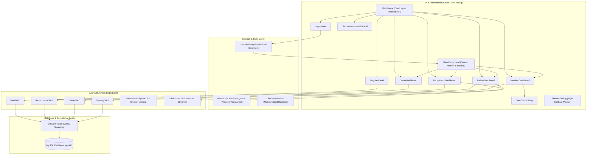
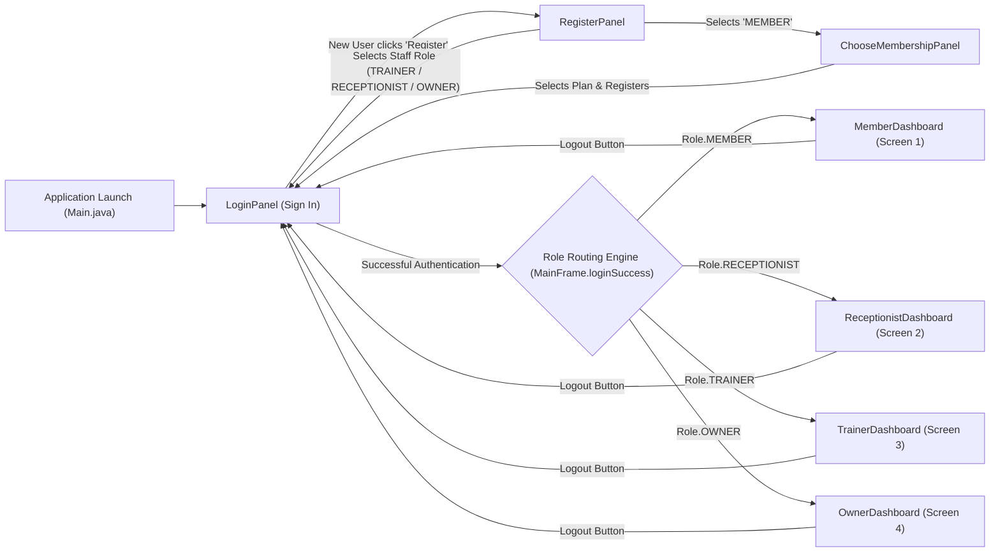
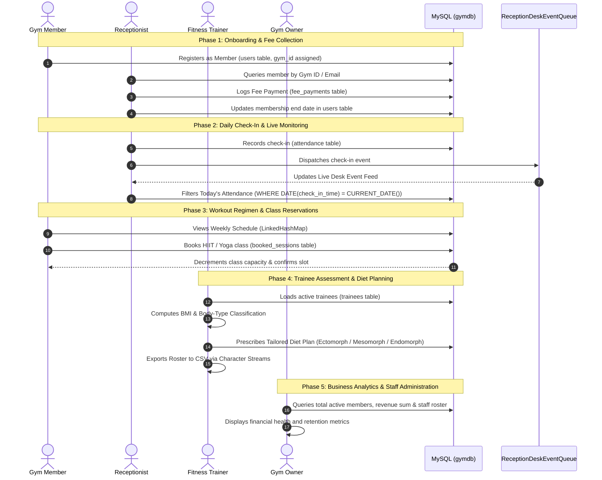
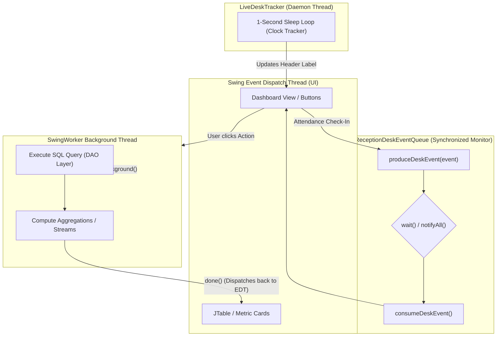

# Dynamis Gym - System Architecture, Dashboard Interconnections & Technical Flow

> **Document:** `flow.md`  
> **Target System:** Dynamis Gym Enterprise Desktop Application  
> **Technology Stack:** Java 17 (Adoptium / HotSpot), Java Swing, MySQL Workbench (`gymdb`), JDBC Connector/J

---

## 1. High-Level System Architecture

Dynamis Gym is built on an enterprise multi-tier **Model-View-Controller (MVC) + Data Access Object (DAO)** architecture. It coordinates four dedicated user workspaces (*Member, Receptionist, Trainer, Gym Owner*) through centralized session tracking, thread-safe asynchronous operations, and unified dark-mode UI rendering.



---

## 2. Dashboard Interconnection & Navigation Flow

All screen transitions in the application are orchestrated by [MainFrame.java](file:///c:/Users/yashx/OneDrive/Desktop/java%20try/src/com/gym/ui/MainFrame.java) using a Swing `CardLayout`. Users never navigate manually through disjoint windows; instead, their authenticated role dictates the active dashboard card.



### Navigation Mechanics
1. **Centralized Authentication**: When credentials are submitted in `LoginPanel`, `UserDAO.login()` verifies the email and validates the PBKDF2 salt-hashed password via `PasswordUtil.verifyPassword()`.
2. **Session Initialization**: On success, the authenticated `User` object is saved to the thread-safe `UserSession.getInstance()`.
3. **Card Switching**: `MainFrame.loginSuccess()` reads `UserSession.getInstance().getCurrentUser().getRole()` and activates the appropriate workspace card:
   - `ROLE_MEMBER` -> `MemberDashboard`
   - `ROLE_RECEPTIONIST` -> `ReceptionistDashboard`
   - `ROLE_TRAINER` -> `TrainerDashboard`
   - `ROLE_OWNER` -> `OwnerDashboard`
4. **Session Cleanup & Logout**: Every dashboard inherits the `BaseDashboard` top bar containing the "Logout" button. Clicking Logout invokes `UserSession.getInstance().clearSession()` and switches the view back to `LoginPanel`.

---

## 3. End-to-End Cross-Dashboard Data Flow

The four dashboards are deeply coupled through the underlying relational schema (`gymdb`). A change initiated in one dashboard directly propagates to the other workspaces.



---

## 4. Technical Concepts & How They Work Together

### 4.1. MVC + DAO + Singleton Patterns
- **Model**: Plain Old Java Objects (POJOs) like `User`, `Trainee`, `DietPlan`, `AttendanceRecord`, `FeePayment`, and `FitnessClass` encapsulate database records with typed getters and setters.
- **View**: Swing panels (`LoginPanel`, `RegisterPanel`, `MemberDashboard`, `ReceptionistDashboard`, etc.) that render the UI.
- **Controller / DAO**: `UserDAO`, `ReceptionistDAO`, `TrainerDAO`, and `BookingDAO` isolate raw SQL queries from the UI layer.
- **Singleton Pattern**:
  - `DBConnection.getInstance()` manages database connection pooling and ensures table initialization happens exactly once.
  - `UserSession.getInstance()` manages active user credentials across the application lifecycle.
  - `ReceptionDeskEventQueue.getInstance()` provides a single, synchronized event pipe across threads.

### 4.2. Multithreading & Asynchronous Processing
- **Daemon Thread (`LiveDeskTracker`)**:
  - Runs in the background with `setDaemon(true)`.
  - Continuously formats the live date/time ("yyyy-MM-dd HH:mm:ss") and pushes updates to the dashboard header without preventing JVM shutdown.
- **`SwingWorker<T, V>` for Responsive UI**:
  - Heavy database queries (loading 100+ attendance records, calculating metrics, exporting files) run in background worker threads (`doInBackground()`).
  - Results are safely published back to the Swing Event Dispatch Thread (EDT) inside `done()`, preventing UI lockups or freezing.
- **Producer-Consumer Inter-Thread Communication (`ReceptionDeskEventQueue`)**:
  - Utilizes intrinsic locking (`synchronized`), guarded conditions, `wait()`, and `notifyAll()`.
  - When the receptionist records or removes a check-in, the action *produces* a desk event onto the queue.
  - The live event ticker *consumes* events and updates the status feed without race conditions.



### 4.3. OOP Inheritance & Custom Exception Architecture
- **Base Dashboard Inheritance**:
  - [BaseDashboard.java](file:///c:/Users/yashx/OneDrive/Desktop/java%20try/src/com/gym/ui/dashboard/BaseDashboard.java) provides common features:
    - User profile card, gym ID display, role badges.
    - Standard metric card generators (`createMetricCard`).
    - Universal table styling (`styleTable`) with 36px row height and padded renderers.
  - `MemberDashboard`, `ReceptionistDashboard`, `TrainerDashboard`, and `OwnerDashboard` extend `BaseDashboard`, reusing common logic while overriding specialized workspaces.
- **Custom Exception Hierarchy**:
  - Base class: `GymException extends Exception`.
  - Derived specialized exceptions:
    - `AuthenticationException`: Invalid credentials, account locked.
    - `MemberNotFoundException`: Lookup by Gym ID / email failed.
    - `ValidationException`: Form validation failures (e.g. invalid phone, negative weight).
  - Clean error propagation allows DAOs to throw typed exceptions while dashboards capture and display readable error dialogs.

### 4.4. Collections Framework, Comparators & Stream API
- **Collections Strategy**:
  - `ArrayList<T>`: Used for dynamic database result sets (trainees, classes, attendance history).
  - `LinkedHashMap<String, WorkoutSlot>`: Used in `MemberDashboard` for the weekly schedule to preserve day-of-week insertion order (Monday through Sunday).
  - `HashMap<String, Trainee>`: Used in `TrainerDAO` for in-memory O(1) caching.
- **Multi-Attribute Sorting via `Comparator`**:
  - `TrainerDashboard` sorts trainees using modular comparators:
    - `Trainee.BY_NAME_ASC = Comparator.comparing(Trainee::getFullName, String.CASE_INSENSITIVE_ORDER);`
    - `Trainee.BY_CURRENT_WEIGHT_DESC = Comparator.comparingDouble(Trainee::getCurrentWeight).reversed();`
    - `Trainee.BY_BODY_TYPE = Comparator.comparing(Trainee::getBodyType);`
- **Stream API Pipelines**:
  - In `TrainerDashboard`, metabolic counts are computed concurrently using functional stream pipelines:
    ```java
    long ectoCount = list.stream().filter(t -> "Ectomorph".equalsIgnoreCase(t.getBodyType())).count();
    long mesoCount = list.stream().filter(t -> "Mesomorph".equalsIgnoreCase(t.getBodyType())).count();
    long endoCount = list.stream().filter(t -> "Endomorph".equalsIgnoreCase(t.getBodyType())).count();
    ```

### 4.5. Character Streams & File Exporting
- `TrainerDAO.exportTraineesToCSV(List<Trainee>, File)` uses `BufferedWriter` and `FileWriter` wrapped in try-with-resources.
- Properly handles CSV escaping, column headers, timestamps, and IO flush operations.
- `TrainerDAO.exportDietPlanToText(DietPlan, File)` generates formatted, human-readable text prescription sheets for clients.

### 4.6. High-Contrast UI & Accessibility Layer
- **Centralized Styler ([Theme.java](file:///c:/Users/yashx/OneDrive/Desktop/java%20try/src/com/gym/ui/Theme.java))**:
  - Standardizes dark backgrounds (`#12151C`, `#1A1D24`, `#202430`), bright text (`#F8F9FA`, `#CBD5E1`), and crimson primary accents (`#F05454`).
  - `Theme.styleComboBox` installs custom dark arrow buttons `▼` and dark popup renderers to eliminate native Windows Look & Feel white-on-white text issues.
- **Themed Modals ([ThemedDialog.java](file:///c:/Users/yashx/OneDrive/Desktop/java%20try/src/com/gym/ui/ThemedDialog.java))**:
  - Completely replaces native `JOptionPane` confirmation and warning dialogs.
  - Paints undecorated rounded modal cards with bold primary ("Yes, Delete", "Assign Plan") and secondary ("Cancel", "Keep Record") buttons, ensuring 100% human visibility.
- **Table Auto-Fit**:
  - Prevents `...` truncation by specifying generous column widths and enabling horizontal scrolling (`AUTO_RESIZE_OFF`).

---

## 5. Practical Scenario Walkthroughs

### Scenario A: Member Registration & Fee Payment
1. **User** opens Dynamis Gym and clicks **"Need an account? Register"**.
2. **User** fills in Full Name, Email, Phone, and Password, selecting the role `MEMBER`.
3. Application opens `ChooseMembershipPanel`; user selects **"Gold Quarterly (90 Days - Rs. 4,500)"**.
4. `UserDAO.register()` saves user and generates unique Roll-Number Gym ID (e.g. `20261001`).
5. **Receptionist** logs into `ReceptionistDashboard`:
   - Enters Member ID `20261001` in **Screen 1: Membership Fee Entry & Invoice**.
   - Selects Payment Mode (UPI / Card / Cash) and clicks **"Process Fee Payment & Print Invoice"**.
   - Database creates a record in `fee_payments` and updates `membership_end_date` in `users`.
   - The invoice text area displays the formatted receipt.

### Scenario B: Daily Check-In & Attendance Deletion (CRUD)
1. Member arrives at the gym; Receptionist navigates to **Screen 3: Live Attendance Desk**.
2. Receptionist enters Gym ID `20261001` and clicks **"Log Member Check-in"**.
3. `ReceptionistDAO.logAttendance()` inserts a row with `CURRENT_TIMESTAMP`.
4. Table reloads with `todayOnly = true` displaying only today's attendance records, matching the **"TODAY'S CHECK-INS"** metric card.
5. If an incorrect check-in was recorded:
   - Receptionist selects the row and clicks crimson **"Delete Selected Check-in"** button.
   - High-contrast `ThemedDialog` confirms deletion.
   - `ReceptionistDAO.deleteAttendanceRecord(id)` executes `DELETE FROM attendance WHERE id = ?`.
   - Live metrics and table refresh immediately, and the event feed logs the removal.

### Scenario C: Class Booking & Seat Capacity
1. Member logs into `MemberDashboard`.
2. Inspects **Weekly Workout Regimen** table (chest, back, legs, cardio targets).
3. Clicks **"Book Group Fitness Class"**; opens `BookClassDialog`.
4. Dialog loads classes from `BookingDAO` showing available seats (e.g., *CrossFit Conditioning: 8 / 15 seats left*).
5. Member clicks **"Confirm Booking"**:
   - `BookingDAO` verifies remaining capacity in a synchronized transaction.
   - Inserts record into `booked_sessions` table.
   - Member dashboard automatically refreshes the **Booked Classes & Sessions** table.

### Scenario D: Trainer Trainee Assessment & Diet Prescription
1. Trainer logs into `TrainerDashboard`.
2. **Screen 1 (My Trainees)** loads all active clients:
   - Trainer filters by `Ectomorph` or sorts by `Weight (High-Low)`.
   - Selects a trainee; assessment form auto-populates credentials and displays the **BMI Status Badge** (e.g., *BMI: 22.9 - Normal / Athletic*).
   - Trainer adjusts target weight, updates coaching notes, and clicks **"Save Assessment & Prescribe Diet Plan"**.
   - Clicks vibrant green **"Export CSV"** to save client roster to disk.
3. **Screen 2 (Diet Plans Catalog)**:
   - Trainer reviews curated plans for Ectomorph, Mesomorph, and Endomorph body types.
   - Inspects the 5 macro tiles (Energy, Protein, Carbs, Fats, Water) and meal schedule text areas.
   - Clicks **"Assign This Plan to Trainee"**; high-contrast modal assigns the plan and updates the trainee's record in MySQL.

### Scenario E: Owner Business Audit & Staff Administration
1. Gym Owner logs into `OwnerDashboard`.
2. Metric tiles instantly aggregate:
   - Total Active Members
   - Total Monthly Revenue (calculated from `fee_payments` via SQL sum)
   - Today's Check-in volume
3. Owner inspects **Staff Roster** table containing all registered trainers and receptionists.
4. Retention and membership tier distributions are displayed for business management.

---

## 6. Summary Quick-Reference Matrix

| Workspace | Primary Java Class | Key DAOs / Services | Multithreading & Asynchronous Tasks | Core Data Tables |
| :--- | :--- | :--- | :--- | :--- |
| **Authentication** | `LoginPanel`, `RegisterPanel` | `UserDAO`, `PasswordUtil` | Password verification on worker thread | `users` |
| **Member** | `MemberDashboard`, `BookClassDialog` | `BookingDAO`, `UserDAO` | Background metric loaders, synchronized class booking | `users`, `booked_sessions` |
| **Receptionist**| `ReceptionistDashboard` | `ReceptionistDAO` | `SwingWorker` data fetching, `ReceptionDeskEventQueue` producer/consumer | `fee_payments`, `attendance`, `users` |
| **Trainer** | `TrainerDashboard` | `TrainerDAO`, `FileExportUtil`| `SwingWorker` trainee filtering, CSV/Text character stream export | `trainees`, `diet_plans`, `users` |
| **Owner** | `OwnerDashboard` | `UserDAO`, `ReceptionistDAO` | Stream aggregation of financial and membership statistics | `users`, `fee_payments`, `attendance` |

---
*Created as part of the Dynamis Gym Enterprise System documentation suite.*
